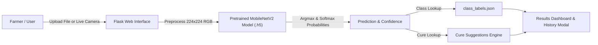

# 🌿 AI Crop Disease Detection & Cure Recommendation System

[](https://www.python.org/)
[](https://flask.palletsprojects.com/)
[](https://www.tensorflow.org/)
[](https://keras.io/)
[](https://opensource.org/licenses/MIT)

An end-to-end intelligent agricultural diagnosis system that detects crop leaf diseases using Deep Learning (Convolutional Neural Networks with Transfer Learning) and delivers immediate, actionable treatment recommendations through an intuitive, interactive web interface.

---

## 📌 Table of Contents

- [Overview](#-overview)
- [Key Features](#-key-features)
- [Supported Crops & Diseases](#-supported-crops--diseases)
- [Architecture & Workflow](#-architecture--workflow)
- [Project Directory Structure](#-project-directory-structure)
- [Getting Started](#-getting-started)
  - [Prerequisites](#prerequisites)
  - [Installation](#installation)
  - [Running the Web Application](#running-the-web-application)
- [Model Training & Testing](#-model-training--testing)
  - [Testing Model Loading](#testing-model-loading)
  - [Retraining the Model](#retraining-the-model)
- [Technologies Used](#-technologies-used)
- [Future Enhancements](#-future-enhancements)
- [Contributing](#-contributing)
- [License](#-license)

---

## 📖 Overview

Crop diseases are a major threat to global food security and cause substantial financial losses for farmers annually. Early and accurate identification is crucial for timely intervention and crop preservation.

This project delivers a complete AI-driven solution:
1. **Automated Leaf Disease Detection**: Classifies **38 distinct health and disease classes** across **14 common crops**.
2. **Actionable Cure Suggestions**: Recommends proven remedies, fungicides, cultural practices, and biological controls immediately upon diagnosis.
3. **Dual Image Input**: Allows farmers and agronomists to either **upload images** or **capture live pictures using a web camera**.
4. **Recent History Tracking**: Maintains a persistent recent inspection history to compare symptoms and monitor plant conditions over time.

---

## ✨ Key Features

- 🧠 **High-Accuracy Deep Learning Model**: Uses **MobileNetV2** with Transfer Learning, optimized for lightweight, low-latency, and high-precision inference.
- 🎯 **Confidence Scoring**: Displays real-time prediction confidence percentage for transparency.
- 💊 **Treatment Recommendations**: Context-aware recommendations for every detected condition (fungicides, organic treatments, pruning, vector control).
- 📷 **Live Camera Integration**: Built-in webcam snapshot capture directly in the browser.
- 🕒 **Diagnosis History**: Circular history quick-access modal displaying the last 3 analyzed crops with thumbnails, results, and treatment plans.
- 🎨 **Responsive UI/UX**: Clean, responsive layout designed for both desktop and mobile field usage.

---

## 🌱 Supported Crops & Diseases

The model classifies **38 distinct classes** spanning 14 agricultural crops:

| Crop | Detectable Conditions |
| :--- | :--- |
| **🍎 Apple** | Apple Scab, Black Rot, Cedar Apple Rust, Healthy |
| **🫐 Blueberry** | Healthy |
| **🍒 Cherry** | Powdery Mildew, Healthy |
| **🌽 Corn (Maize)** | Cercospora / Gray Leaf Spot, Common Rust, Northern Leaf Blight, Healthy |
| **🍇 Grape** | Black Rot, Esca (Black Measles), Leaf Blight (Isariopsis Spot), Healthy |
| **🍊 Orange** | Huanglongbing (Citrus Greening) |
| **🍑 Peach** | Bacterial Spot, Healthy |
| **🫑 Bell Pepper** | Bacterial Spot, Healthy |
| **🥔 Potato** | Early Blight, Late Blight, Healthy |
| **🍇 Raspberry** | Healthy |
| **🌱 Soybean** | Healthy |
| **🎃 Squash** | Powdery Mildew |
| **🍓 Strawberry** | Leaf Scorch, Healthy |
| **🍅 Tomato** | Bacterial Spot, Early Blight, Late Blight, Leaf Mold, Septoria Leaf Spot, Spider Mites, Target Spot, Tomato Yellow Leaf Curl Virus, Tomato Mosaic Virus, Healthy |

---

## 🏗️ Architecture & Workflow



1. **Input**: User uploads a leaf photo or captures one via webcam.
2. **Preprocessing**: The image is resized to `(224, 224)` and pixel values are normalized to `[0, 1]`.
3. **Inference**: The compiled Keras model computes class probabilities across all 38 categories.
4. **Advisory**: The system maps the prediction index to its label, calculates confidence score, and matches the disease with treatment guidelines.
5. **Output**: The user receives a clear diagnosis along with immediate treatment steps and adds the result to their diagnosis history.

---

## 📁 Project Directory Structure

```text
AI-Crop-Disease/
├── app.py                         # Flask web application & API routing
├── class_labels.json              # 38 crop disease class labels
├── plant_disease_model.h5         # Pre-trained MobileNetV2 weights
├── train.py                       # Model training & fine-tuning script
├── test_model.py                  # Sanity script to verify model loading
├── plant_disease_training.ipynb   # Jupyter / Colab training notebook
├── requirements.txt               # Python package dependencies
├── README.md                      # Comprehensive project documentation
├── TODO.md                        # Task tracker and implementation notes
├── .gitignore                     # Git ignore rules
├── static/                        # Static assets
│   ├── style.css                  # Modern UI styles & layout
│   ├── script.js                  # Webcam handling & modal interactivity
│   └── uploads/                   # Runtime leaf image uploads
└── templates/
    └── index.html                 # Main web application dashboard
```

---

## 🚀 Getting Started

Follow these instructions to set up and run the project locally.

### Prerequisites

- **Python**: Version 3.10 or 3.11 recommended.
- **Git**: Installed on your system.
- **Webcam** (Optional): For live leaf snapshot diagnosis.

---

### Installation

1. **Clone the repository:**
   ```bash
   git clone https://github.com/Rockingrushi/AI-Crop-Disease-1.git
   cd AI-Crop-Disease-1
   ```

2. **Create and activate a virtual environment:**
   - **Windows (PowerShell):**
     ```powershell
     python -m venv venv
     .\venv\Scripts\Activate.ps1
     ```
   - **Windows (Command Prompt):**
     ```cmd
     python -m venv venv
     venv\Scripts\activate.bat
     ```
   - **Linux / macOS:**
     ```bash
     python3 -m venv venv
     source venv/bin/activate
     ```

3. **Install dependencies:**
   ```bash
   pip install --upgrade pip
   pip install -r requirements.txt
   ```

---

### Running the Web Application

1. **Start the Flask server:**
   ```bash
   python app.py
   ```

2. **Open the application in your browser:**
   ```text
   http://127.0.0.1:5000
   ```

3. **Diagnose a leaf:**
   - Click **Choose File** to upload a leaf image, or use the **Camera** button to take a live photo.
   - Click **Predict Disease**.
   - View the detected condition, confidence percentage, and recommended cure.
   - Click the **H** (History) button on the top-left to view recent analyses.

---

## 🔬 Model Training & Testing

### Testing Model Loading

To verify that the model loads properly and view its architecture summary:
```bash
python test_model.py
```

### Retraining the Model

To train the model from scratch on the **PlantVillage (New Plant Diseases)** dataset:

1. Configure your Kaggle API key (`kaggle.json`) in `~/.kaggle/` or set environment variables:
   ```bash
   export KAGGLE_USERNAME="your_username"
   export KAGGLE_KEY="your_api_key"
   ```

2. Run the training pipeline:
   ```bash
   python train.py
   ```
   This will:
   - Download and extract the dataset automatically.
   - Apply data augmentation (`ImageDataGenerator`).
   - Transfer learn on **MobileNetV2** (pre-trained on ImageNet).
   - Export the trained weights to `plant_disease_model.h5` and labels to `class_labels.json`.

---

## 🛠️ Technologies Used

- **Deep Learning / Machine Learning**:
  - [TensorFlow 2.17](https://www.tensorflow.org/) & [Keras](https://keras.io/)
  - [MobileNetV2](https://arxiv.org/abs/1801.04381) (Transfer Learning)
  - [NumPy](https://numpy.org/) for multi-dimensional array operations
  - [Pillow (PIL)](https://python-pillow.org/) for image processing
- **Backend**:
  - [Flask 3.0](https://flask.palletsprojects.com/) (WSGI Web Framework)
- **Frontend**:
  - HTML5, CSS3, Modern Vanilla JavaScript
  - Responsive Grid & Flexbox
  - HTML5 MediaDevices API (Webcam live capture)

---

## 🔮 Future Enhancements

- 📱 **Progressive Web App (PWA)**: Offline-first mobile deployment for remote rural farms without internet connectivity.
- 🗣️ **Multilingual Support**: Regional voice & text translations for localized farming communities.
- 🌦️ **Weather API Integration**: Correlating humidity and temperature forecasts with fungal outbreak risks.
- 🛰️ **Drone / Field Batch Scanning**: Processing multi-spectrum aerial farm imagery in batches.

---

## 🤝 Contributing

Contributions, issues, and feature requests are welcome!
1. Fork the Project
2. Create your Feature Branch (`git checkout -b feature/AmazingFeature`)
3. Commit your Changes (`git commit -m 'Add some AmazingFeature'`)
4. Push to the Branch (`git push origin feature/AmazingFeature`)
5. Open a Pull Request

---

## 📄 License

This project is open-source and distributed under the [MIT License](LICENSE).